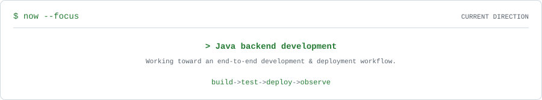
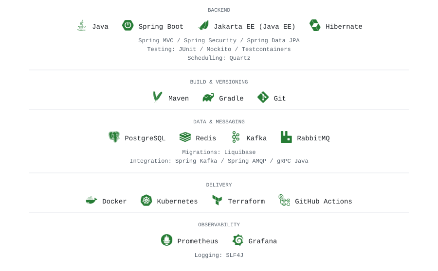
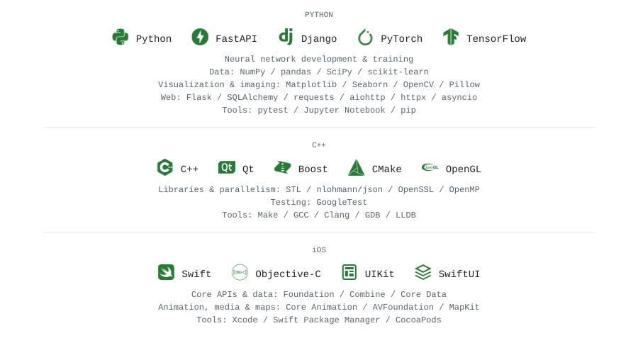
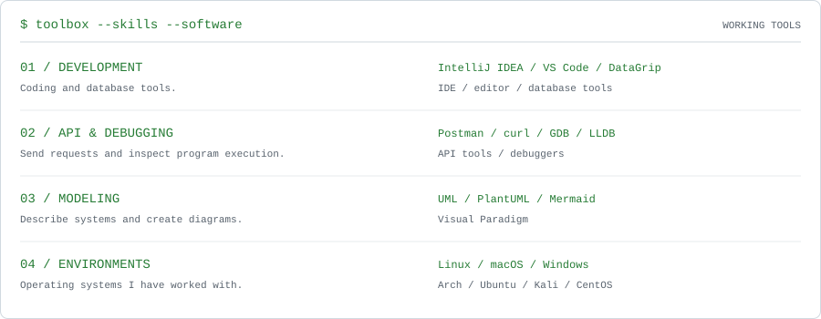
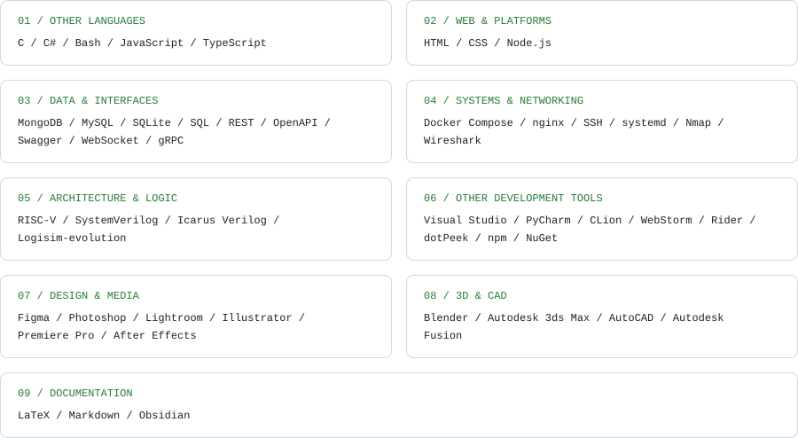

<picture>
  <source media="(prefers-color-scheme: dark)" srcset="assets/banner.dark.svg">
  <source media="(prefers-color-scheme: light)" srcset="assets/banner.light.svg">
  
</picture>

### `> whoami`

Hello there! I'm **GreenZV**

<picture>
  <source media="(prefers-color-scheme: dark)" srcset="assets/now.dark.svg">
  <source media="(prefers-color-scheme: light)" srcset="assets/now.light.svg">
  
</picture>

### `> activity`

<picture>
  <source media="(prefers-color-scheme: dark)" srcset="assets/contributions.dark.svg">
  <source media="(prefers-color-scheme: light)" srcset="assets/contributions.light.svg">
  
</picture>

### `> projects`

<!-- Add project cards and repository links here. -->

### `> stack`

<picture>
  <source media="(prefers-color-scheme: dark)" srcset="assets/stack.dark.svg">
  <source media="(prefers-color-scheme: light)" srcset="assets/stack.light.svg">
  
</picture>

### `> experience`

Python, C++ &amp; iOS development

<picture>
  <source media="(prefers-color-scheme: dark)" srcset="assets/experience.dark.svg">
  <source media="(prefers-color-scheme: light)" srcset="assets/experience.light.svg">
  
</picture>

### `> additional experience`

Tools, platforms, design &amp; university projects

Additional hands-on experience through personal projects and university coursework.

**Toolbox**

<picture>
  <source media="(prefers-color-scheme: dark)" srcset="assets/toolbox.dark.svg">
  <source media="(prefers-color-scheme: light)" srcset="assets/toolbox.light.svg">
  
</picture>

**More technologies &amp; software**

<picture>
  <source media="(prefers-color-scheme: dark)" srcset="assets/additional-experience.dark.svg">
  <source media="(prefers-color-scheme: light)" srcset="assets/additional-experience.light.svg">
  
</picture>

### `> contact`

<a href="https://github.com/GreenZV"><picture>
  <source media="(prefers-color-scheme: dark)" srcset="assets/contacts/github.dark.svg">
  <source media="(prefers-color-scheme: light)" srcset="assets/contacts/github.light.svg">
  
</picture></a>

